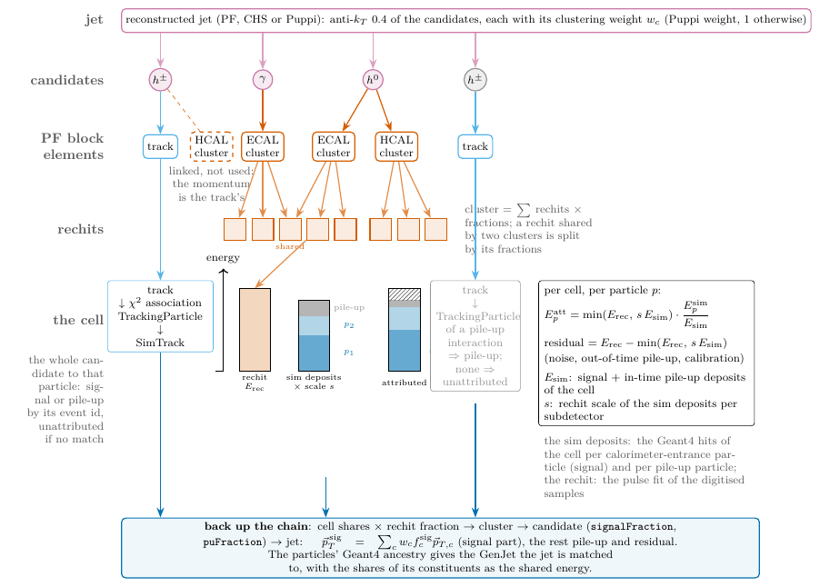
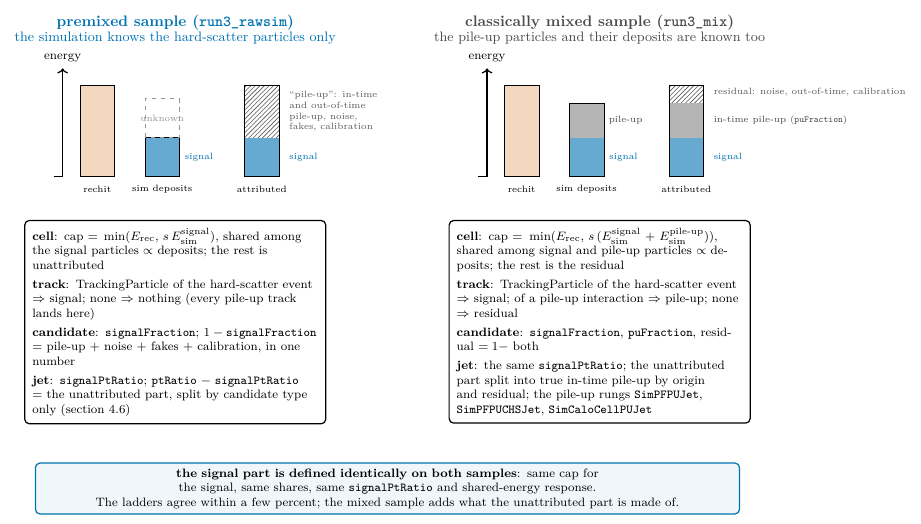
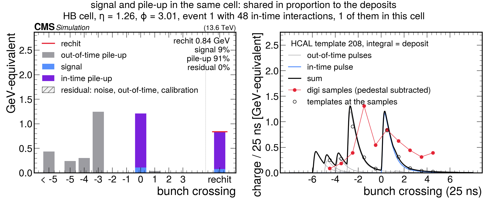
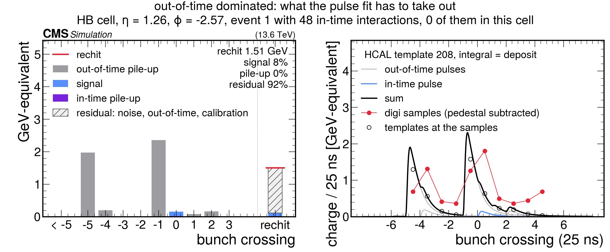
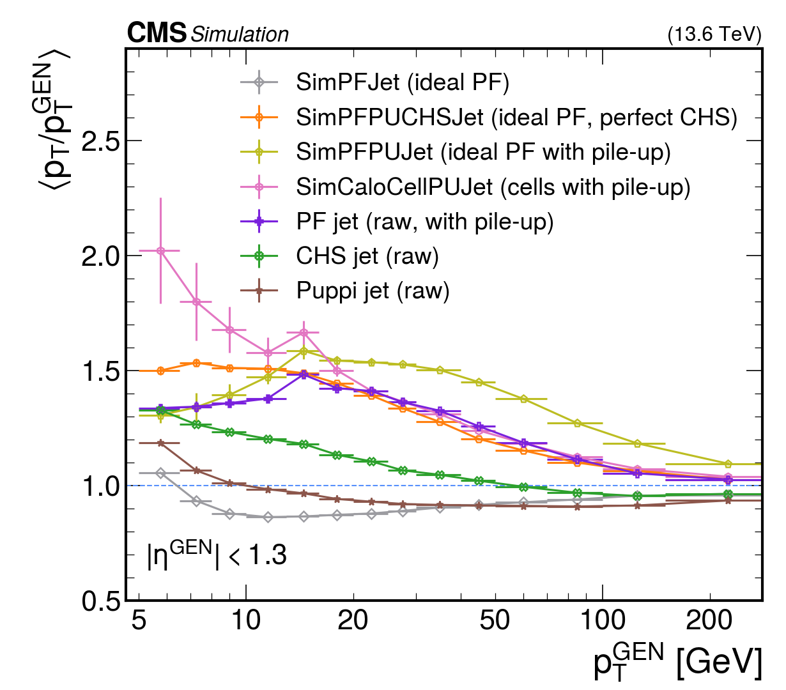
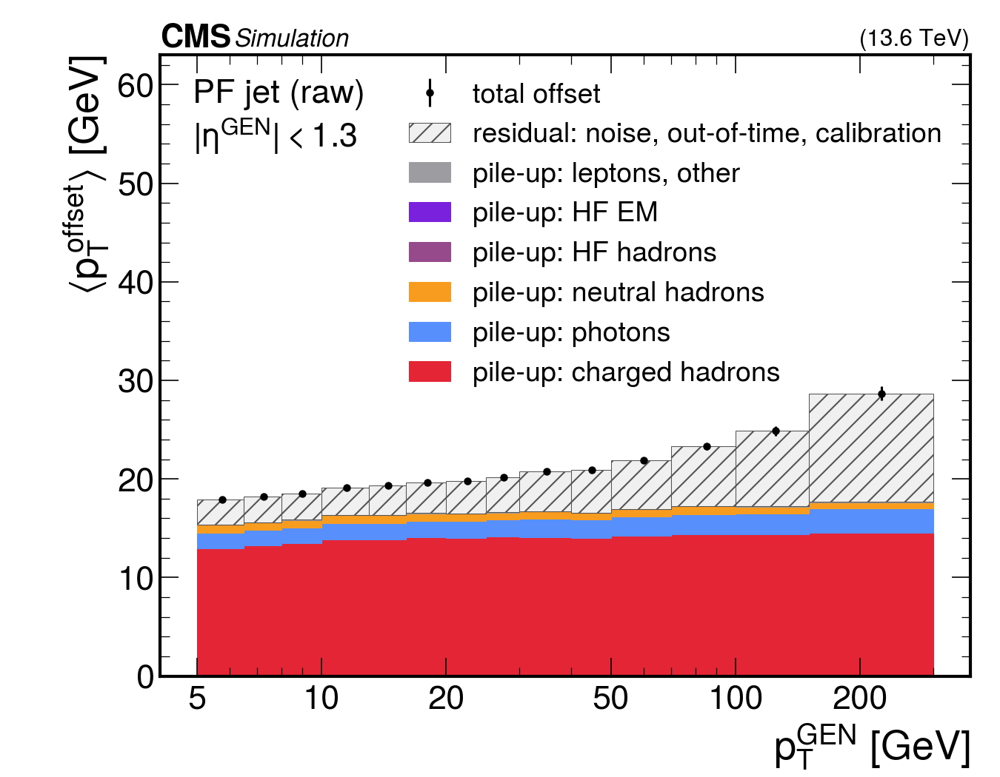
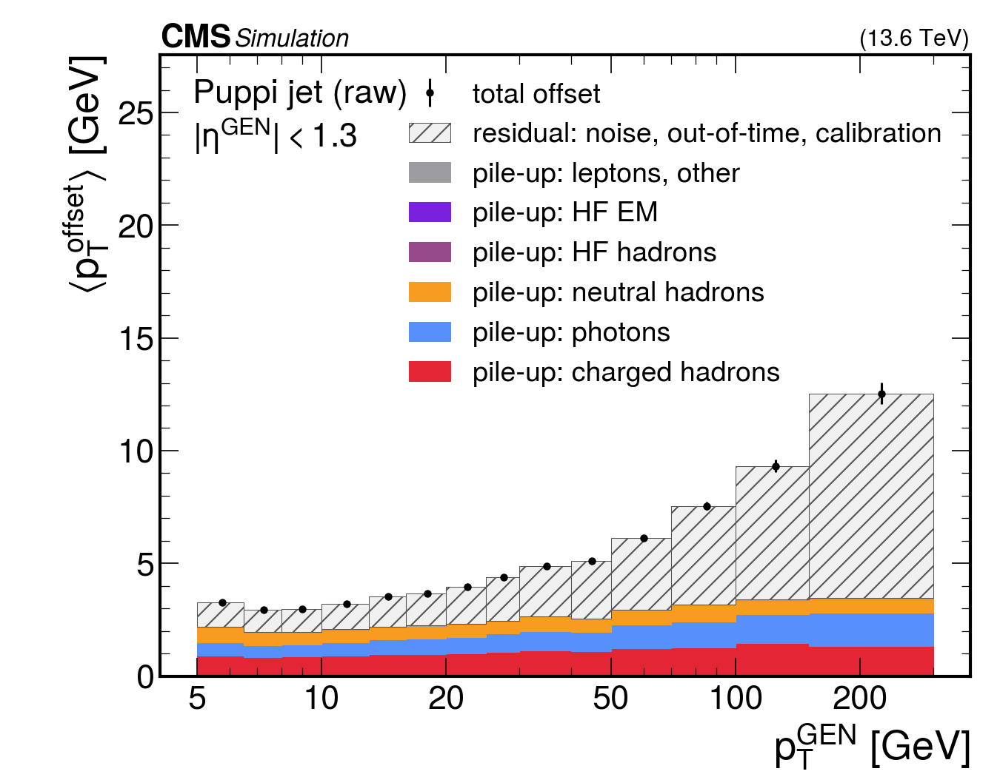

# TrueJES: where the jet energy scale comes from

A jet energy scale measured on reconstructed jets mixes many effects: what
happened to the particles before they reached the detector, what the
calorimeter does to them, what tracking recovers, what the reconstruction
algorithms add or lose, and the pile-up. This study separates them by
building one jet collection per step on the same simulated events and
matching every step to the same generator jet without any geometric
criterion. It uses the Reco2Pico Picos of the `run3_rawsim` chain
(GEN-SIM-RAW re-reconstructed with the simulation truth kept) on the
Run3Winter26 `DYto2Mu-4Jets` sample (2026 pile-up conditions), and the
`analysis/TrueJES` package.

## 1. The ladder

| step | jet | definition | what the step adds |
|---|---|---|---|
| 1 | `GenJet` | anti-kt 0.4 of the generator particles, no neutrinos (`ak4GenJetsNoNu`), re-clustered in the Pico job | the reference |
| 2 | `SimJet` | anti-kt 0.4 of the calorimeter-entrance particles of the signal event: the Geant4 `SimTrack`s at the tracker/calorimeter boundary, no neutrinos, with their production momenta (knocked-out nucleons by kinetic energy) | the particle list after the tracker: decays in flight (pi, K, K0S, Lambda; neutrinos lost, daughters out of cone), conversions, nuclear interactions |
| 3 | `SimBoundaryJet` | the same particles with the momentum Geant4 recorded at the crossing | energy loss in the tracker material and the bending of charged particles (soft ones leave the cone) |
| 4 | `SimCaloJet` | anti-kt 0.4 of the calorimeter deposits summed from the Geant4 sim hits per entrance particle (`SimCalo`), everything taken from the calorimeter; `SimCaloCellJet` clusters the same deposits as cells | the calorimeter response: non-compensation, invisible energy, leakage, dead material (and, between the two variants, the shower geometry) |
| 5 | `SimPFJet` | anti-kt 0.4 of an ideal particle flow (`SimPFCand`): charged entrance particles within acceptance and above 0.5 GeV with their momentum, everything else with its deposit | what perfect tracking recovers |
| 6 | `PFJet`, `PFJetCHS`, `PFJetPuppi` | the reconstructed jets, re-clustered raw (no JEC) with the standard definitions | the reconstruction: thresholds, clustering, the PF algorithm, and the pile-up with no, CHS or Puppi mitigation |
| 7 | `PFJetPuppi` times `jecL1L2L3` | the Puppi jet with the GlobalTag AK4PFPuppi corrections (factors stored per jet; CHS has no valid corrections in CMSSW) | the jet energy corrections, applied to the full jet or, as L2L3 only, to its signal part |

### 1.1 The definitions in detail

All jets are anti-kt with R = 0.4, raw (no corrections unless the step says
so), clustered in the Pico job so that their constituents are known, and
matched to the same gen jet by ancestry (section 2). The table above says
what each step adds; this section says exactly what goes into each one.

**GenJet.** The generator's final-state particles (status 1) without
neutrinos, the `ak4GenJetsNoNu` definition re-clustered in the job. The
reference of every response below.

**The calorimeter-entrance particles.** The one truth stage between the
generator and the calorimeter. Geant4 propagates the generator particles
through the tracker, where they decay, convert, interact in the material,
lose energy by ionisation and bend in the field; the particles that arrive at
the calorimeter face are the ones every later step sees. They are the cut
through the stored Geant4 decay tree (the `SimTrack` collection) at the
tracker/calorimeter boundary, which Geant4 records at r = 123.3 cm and
|z| = 293.2 cm.

The Geant4 bookkeeping that the definition is read from
(`SimG4Core/Notification/MCTruthUtil`, `SimG4CMS/Calo/CaloTrkProcessing`,
`CaloSD`):

* a stored secondary, i.e. a decay or conversion product of a primary (the
  only secondaries Geant4 keeps as SimTracks besides what made tracker hits),
  gets its own "id on the calorimeter surface" at creation; unstored
  secondaries inherit the id of their mother;
* the boundary-crossing flag (`SimTrack_crossedBoundary`, with the position
  and momentum at the crossing) is set only for a track whose id is still
  zero when it steps into a calorimeter volume: primaries and unstored
  chains get it, a stored secondary born in the tracker never does;
* every calorimeter sim hit carries the id on the surface of the particle
  that deposited it, so the hits of a stored daughter born inside the
  calorimeter reference the daughter, not the particle that entered;
* at the end of the event the hits of a particle that was not saved as a
  SimTrack are re-keyed to its nearest saved ancestor, so a saved photon
  that converted in the tracker, or a saved pi0, can own the hits of unsaved
  descendants, while a saved secondary that inherited its mother's id (a
  bremsstrahlung photon, a delta ray, a continuation entry of the same
  particle) owns nothing: its hits are the mother's.

The rule, applied top-down through the tree (`PicoCaloEntranceProducer`):

* a SimTrack born outside the tracker volume belongs to the entrance
  particle of its parent when the parent has one (born in the calorimeter:
  its hits are assigned to that ancestor); otherwise it is an entrance
  particle itself if it owns hits (a bookkeeping fallback, rare);
* a SimTrack born inside the tracker volume is an entrance particle if it
  crossed the boundary (flag), or "reaches the calorimeter": it owns
  calorimeter sim hits, or a chain of daughters born outside the tracker
  volume does. A tracker-born daughter of an entrance particle (a
  bremsstrahlung photon or a delta ray emitted before the face) is judged
  on its own: a separate entrance particle if it reaches the calorimeter,
  lost otherwise;
* everything else is before the boundary: decayed, converted or absorbed in
  the tracker, replaced by its daughters or lost. Neutrinos are dropped.

Every calorimeter sim hit is thereby bookkept to exactly one entrance
particle. Examples: a photon converting in the tracker is replaced by its two
electrons, each with its own momentum at the face and its own deposit; a
photon converting in the crystals is the entrance particle and the electrons'
hits are merged into it; a pi+ decaying in flight in the tracker is replaced
by its muon, the neutrino is lost; a K0S decaying inside ECAL is the entrance
particle and the hits of its pions are merged into it; a muon with delta rays
in the muon system is one particle; a pion interacting in the tracker
material is replaced by the stored products that own their hits, and keeps
whatever energy of unsaved products was re-keyed to it.

Two momenta go with every entrance particle (`SimTrack_entrancePt/E`,
`SimTrack_facePt/E`):

* *production*: the momentum at creation, scaled down along its direction by
  the entrance energy found in its tracker-born subtree (its tracker-born
  daughters that are entrance particles themselves, and the entrance
  particles below a tracker-born daughter that is not one, such as a product
  that decayed before the face or the continuation entries Geant4 writes for
  an electron after each bremsstrahlung), so that a radiated photon counted
  on its own is not counted twice. It is zero when the daughters carry
  everything (a pi0 whose photons own their hits). Nucleons and nuclei born
  at a hadronic interaction vertex were knocked out of the tracker material
  and count with their kinetic energy only, since their rest mass never
  entered. With this, the entrance energy of the descendants of a generator
  particle sums to 0.99 of its energy;
* *at the face*: the momentum Geant4 recorded at the boundary crossing, after
  the ionisation loss and the bending in the tracker, or the production one
  where no crossing was recorded.

**SimJet.** Anti-kt of the entrance particles with their production
momenta. Directions are those at the vertex, as for the gen jet, so it
measures what the particle list itself costs: the neutrinos of decays in
flight, the daughters that leave the cone, the products absorbed before the
face, the energy balance of nuclear interactions.

**SimBoundaryJet.** The same particles with their momentum at the face. On
top of SimJet it adds the ionisation loss in the tracker material and the
bending: a charged particle of transverse momentum p is displaced by about
0.7/p rad in phi at the face (0.3 B R / 2p with B = 3.8 T, R = 1.29 m), so
everything below about 2 GeV leaves the 0.4 cone. It is the geometry every
calorimeter-side object inherits, and the reference against which the
calorimeter response proper should be read.

**SimCalo and SimCaloJet.** For every entrance particle the sum of its sim
hits in ECAL, preshower, HCAL, HO and HF, as one massless candidate along the
energy-weighted direction of its cells (`SimCalo`, with the per-subdetector
energies, the number of cells and the number of SimTracks merged into it).
Charged particles are taken from the calorimeter like everything else. The
deposits are GeV-equivalent on the digitiser's scale: the HCAL hits are
relabelled from the Geant4 test numbering to `HcalDetId` and scaled with the
digitiser's sampling factors (`hcalSimParameters`, era modifiers applied),
the HF photoelectrons with the HF factors (not validated, low; irrelevant
inside the tracker acceptance). Cells are summed over all particles first, an
optional per-cell threshold (`ecalCellThreshold`, `hcalCellThreshold`,
default 0) applies to the cell total as a rechit threshold would, and the
cell energy is then shared between the contributing particles in proportion
to their deposits. The sim hits exist for the signal event only, so there is
no pile-up and no noise. `SimCaloJet` is anti-kt of these deposits and adds
the calorimeter response: non-compensation, invisible energy, leakage, dead
material.

**SimCaloCell and SimCaloCellJet.** The same energy as cells instead of
particles: one massless candidate per cell above threshold, with its total
signal deposit, at the cell centre (`SimCaloCell`: subdetector, DetId,
energy, direction, number of particles sharing it). `SimCaloCellJet` is
anti-kt of the cells: identical energy to `SimCaloJet` with the real shower
geometry (energy spread beyond the cone, cells shared between jets) instead
of one direction per particle, so the pair separates the energy response from
the geometry. Its gen-jet match splits every cell between the entrance
particles in proportion to their deposits, so the ancestry scores stay exact.
It is the signal-only, noiseless, cell-level truth of what the calorimeter
saw before any tower or cluster building: finer than a CaloTower (every
crystal and every HCAL depth is its own row), without the pile-up, noise,
calibration and zero-suppression of the reconstruction, and with the truth
decomposition attached.

**SimPFCand and SimPFJet.** An ideal particle flow over the entrance
particles: a particle that is charged, born inside the tracker volume, within
|eta| < 2.5 and above 0.5 GeV enters with its production momentum as an
entrance particle (perfect tracking, `kind` 1); every other particle enters
with its deposit (`kind` 2 neutral, 3 charged but not trackable) or not at
all if it left none. `SimPFJet` is anti-kt of this list; it adds what
perfect tracking recovers over the calorimeter and is the ceiling of what the
PF reconstruction can reach from these inputs. Its deposits are raw, so a
calibrated PF cluster can sit above it where the raw deposits are lowest (the
endcap at low pT).

**PFJet, PFJetCHS, PFJetPuppi.** The reconstructed jets re-clustered in the
job with the standard definitions: all `particleFlow` candidates; the
`pfNoPileUpJME` candidates for CHS; the candidates with their `puppi`
weights for Puppi. Raw, with the pile-up of the sample (2026 conditions).
Every constituent is attributed to the simulated particles of the signal
event (`PFCandTruth`, section 3): a candidate with a track through the track
to TrackingParticle association, any other candidate through its clusters
cell by cell, the reconstructed cell energy shared among the signal
particles in proportion to their sim-hit deposits and capped by the
GeV-equivalent sim energy of the cell. This gives two responses per jet: the
plain `ptRatio`, and `signalPtRatio`, the pT of the attributed part of the
constituents (clustering weight times signal fraction times pT) over the gen
pT, i.e. the response of the *signal part* with the pile-up removed by
attribution rather than by an algorithm. The difference between the two is
the pile-up of that jet, broken down by candidate type in the offsets
(section 4.6).

**Puppi, JEC-corrected.** The raw Puppi jet times the GlobalTag AK4PFPuppi
L1FastL2L3 factor stored per jet (`PFJetPuppi_jecL1L2L3`), i.e. what an
analysis sees; and the signal part times the L2L3 part only
(`jecL1L2L3 / jecL1`), since the signal has no pile-up left to subtract. CHS
has no valid corrections in CMSSW, so only Puppi is corrected.

**Reading the ladder.** Each difference isolates one effect on the same gen
jets: SimJet versus GenJet the tracker's particle list; SimBoundaryJet versus
SimJet the material and the bending; SimCaloJet versus SimBoundaryJet the
calorimeter response; SimCaloCellJet versus SimCaloJet the shower geometry;
SimPFJet versus SimCaloJet the tracking recovery; the signal parts versus
SimPFJet the reconstruction itself; the raw jets versus their signal parts
the pile-up; the corrected jet versus one the quality of the corrections.
In the first production, built on a "terminal particle" rule instead of the
entrance particles, 4% of the deposited energy was dropped from the ideal PF
list and 7% sat on daughters born inside the calorimeter; the details and the
Geant4 references are in the PicoProducer README.

## 2. Matching without geometry

At low pT the field shifts charged constituents in phi and decays in flight
move energy around, so a deltaR match is ambiguous exactly where the response
is interesting. Every SimTrack descends from one generator primary through
the stored decay tree, and every generator particle is a constituent of at
most one gen jet; a jet at any step is therefore matched to gen jets through
the ancestry of its constituents, in the spirit of the HGCAL trackster
scores. For a (jet j, gen jet g) pair:

* `sharedEnergy`: energy of the constituents of j descending from g;
* `simFraction` (or `recoFraction`) = sharedEnergy / E(j): purity of j;
* `genFraction`: share of the gen jet energy whose descendants, as clustered
  (or as reconstructed), ended up in j: efficiency of g into j.

For the reconstructed jets the constituents are PF candidates, first
attributed to simulated particles: charged candidates through the track to
TrackingParticle association, the others cell by cell through the sim-hit
shares of their cluster cells, capped by the simulated energy of the cell.
What is not attributed is pile-up, noise or fakes, and `signalPtRatio` is
the response of the attributed part alone.

A gen jet counts as matched at a step when the pair flagged best for it has
both fractions above 0.5. Gen jets within 0.4 of a generator muon above
10 GeV (the Z decay) are excluded.

## 3. Pile-up: attribution, not subtraction

Pile-up is not subtracted from the reconstructed jets and no pile-up
matching between samples is done. Instead every PF candidate is split into a
part that can be traced to a simulated particle of the hard-scatter event and
a remainder, and the "signal part" of a jet is the sum of the traced parts of
its constituents (`analysis/TrueJES/illustrations/pileup_attribution.pdf`).
The whole chain is taken apart down to the rechits: the jet to its candidates,
each candidate to the block elements it was built from (a track, or PF
clusters), each cluster to its rechits with their fractions, and the rechit is
the cell in which the simulated deposits per particle are known. The
attribution happens in that cell and is summed back up the same chain
(`illustrations/attribution_chain.pdf`, figure below).

**Per candidate** (`PFCandTruth`, with the individual shares in `PFCandSim`):

* A candidate with a track (charged hadrons, electrons, muons): the track is
  associated to a TrackingParticle by the chi2 associator, the TrackingParticle
  leads to its SimTrack, and the whole candidate energy is attributed to that
  particle. A track without an associated TrackingParticle gets nothing. The
  sample is premixed, so TrackingParticles exist for the hard-scatter event
  only, and every pile-up track falls in the "nothing" category automatically.
* A candidate without a track (photons, neutral hadrons, HF): through its PF
  clusters, cell by cell. The reconstructed energy of a cell is the rechit
  energy times the cluster fraction. The simulated deposit of every
  hard-scatter particle in that cell is known from the sim hits. The attributed
  energy of the cell is the smaller of the reconstructed energy and the total
  simulated signal energy of the cell, shared among the particles in proportion
  to their deposits; the rest stays unattributed. The sim hits, too, exist for
  the hard-scatter event only, so energy without a simulated counterpart is
  pile-up, noise or a fake.
* The attributed energies are rescaled from the raw cell sum to the calibrated
  candidate energy and summed: `signalFraction` is the attributed share of the
  candidate, `simTrackIdx` the dominant particle.

**Per jet** (`<Jet>GenMatch`): each constituent contributes its clustering
weight times its signal fraction times its momentum vector; the pT of the
vector sum over the jet divided by the gen jet pT is `signalPtRatio`. The
difference to the plain `ptRatio` of the same jet is the pile-up contribution,
jet by jet. The shared-energy response is the stricter observable: it keeps
only the shares whose particle descends from the matched gen jet's own
constituents.

Two details to keep in mind:

* "Signal" means any particle of the hard-scatter event, including the
  underlying event and other jets of that event, not only the gen jet in
  question; the shared-energy response is the one restricted to the gen jet.
* The cap by the simulated cell energy is what protects against pile-up
  sitting on top of a small signal deposit: without it, a cell with 50 MeV of
  signal and 2 GeV of pile-up would be attributed entirely to the signal
  particle.

**On the premixed sample** (`run3_rawsim`, sections 4 and the `TrueJES` web
folder) this is the whole story: the simulation knows the hard-scatter
particles only, so the cap is the signal deposit of the cell, a track without
a TrackingParticle gets nothing, and "pile-up" is everything that is not
attributed: the in-time and out-of-time pile-up, the noise, the fakes and the
calibration residual of the cap, all in one number per candidate
(`1 - signalFraction`) and per jet (`ptRatio - signalPtRatio`). The offsets
of section 4.6 are this unattributed part split by candidate type. Nothing
more can be said about its origin on that sample.

**On the classically mixed sample** (`run3_mix`, section 5 and the
`TrueJES_mix` web folder) the same attribution runs with the pile-up
particles known: the cap becomes the signal plus in-time pile-up deposit of
the cell, the pile-up particles get their shares (`puFraction`), a pile-up
track is attributed through its own TrackingParticle, and what is left is the
residual, now only noise, out-of-time pile-up and the calibration residual.
The signal part is defined identically on both samples, which is why the
ladders agree and the two sets of figures can be read side by side; the
mixed sample adds the split of the unattributed part into true pile-up by
origin and residual, and the pile-up rungs of the ladder
(`illustrations/attribution_samples.pdf`, figure below).

As a result the raw PF, CHS and Puppi jets show what each mitigation leaves
in at the pile-up of the sample, while the signal part is independent of it.
On the production (2026 conditions), central jets at 15 to 30 GeV read
PF 1.46, CHS 1.19, Puppi 0.97 raw, and 0.80, 0.77, 0.77 for the signal part.

## 4. Results

Production v4 of 17 October 2026 (the calorimeter-entrance definition of
section 1; v1 and v2 of 16 October used the earlier terminal-particle rule):
30 files of the sample, 56 119 events, 299 Condor jobs
(`samples_workflows/run3_rawsim/submit_rawsim_bdriver.sh`, `MAX_FILES=30`),
analysed with `analysis/TrueJES/run_truejes.sh`. Hadronic
gen jets above 5 GeV: 301 k in total, 96.5 k in the barrel (|eta| < 1.3),
87.0 k in 1.3 < |eta| < 2.5. All jets are raw (no JEC); the sim-level deposits
are on the digitiser's GeV scale, not calibrated. The plots quoted below are in
`docs/figures/` (copies of `analysis/TrueJES/plots/`).

### 4.1 Two response observables

* `ptRatio`, <pT/pT_GEN> of the matched jet (`response_vs_pt/ladder_sim_<region>` for the simulation-level steps, `ladder_reco_<region>` for the reconstructed ones with the ideal PF as the reference):
  what one usually calls the response. At low pT it includes whatever foreign
  energy the matched jet picked up (underlying event, neighbours), which the
  purity requirement allows up to 50%.
* the shared-energy response <E_shared/E_GEN> (`response_vs_pt/shared_sim_<region>`, `shared_reco_<region>`):
  only the energy of the matched jet that descends from the gen jet. It is the
  retention of the gen jet's own energy through the step and is free of the
  foreign-energy pick-up. The two differ exactly where the gen jet is small
  compared to its surroundings.
* the composition by flavour (`composition/composition_<region>_<coll>`): the
  fraction of the gen jet pT carried by charged hadrons, photons, neutral
  hadrons and leptons at the generator; by the charged particles taken from
  their momentum and the neutral and untrackable ones taken from their deposit
  in the ideal PF; and by each PF candidate type in the signal part of the
  reconstructed jet. Read column by column it says how much of each component
  survives the calorimeter and the reconstruction, i.e. the matching
  efficiency per flavour.
* one cell at a time (`cells_matching_cases/<case>__<event>`: a signal-only cell, a cell shared by signal and pile-up, a pile-up-only cell and an out-of-time dominated one, classically mixed sample
  only, `analysis/CaloPulses/plot_cell_pulse.py`): the simulated deposits of a calorimeter cell per
  bunch crossing, the waveform the digitiser samples from them, and the rechit
  with its attribution into signal, pile-up and the residual; the concrete
  content of the per-cell attribution of section 3.

### 4.2 The barrel ladder

Mean response in three gen-pt bins, |eta| < 1.3 (plain ratio / shared-energy
response):

| step | 13 to 16 GeV | 30 to 40 GeV | 100 to 150 GeV |
|---|---|---|---|
| SimJet (entrance particles, production momenta) | 0.97 / 0.86 | 0.96 / 0.92 | 0.97 / 0.96 |
| SimBoundaryJet (momenta at the calorimeter face) | 0.82 / 0.67 | 0.79 / 0.73 | 0.88 / 0.86 |
| SimCaloJet (calorimeter deposits) | 0.72 / 0.63 | 0.77 / 0.74 | 0.91 / 0.90 |
| SimCaloCellJet (calorimeter cells) | 0.72 / 0.63 | 0.77 / 0.73 | 0.90 / 0.88 |
| SimPFJet (ideal particle flow) | 0.86 / 0.79 | 0.91 / 0.88 | 0.95 / 0.94 |
| PF jet, signal part | 0.80 / 0.72 | 0.84 / 0.80 | 0.89 / 0.88 |
| CHS jet, signal part | 0.77 / 0.71 | 0.82 / 0.79 | 0.88 / 0.87 |
| Puppi jet, signal part | 0.77 / 0.73 | 0.81 / 0.79 | 0.87 / 0.86 |
| PF jet, raw (with pile-up) | 1.46 | 1.35 | 1.07 |
| CHS jet, raw | 1.19 | 1.05 | 0.97 |
| Puppi jet, raw | 0.97 | 0.93 | 0.93 |
| Puppi jet, JEC-corrected (GlobalTag L1FastL2L3) | 1.11 | 1.05 | 1.03 |
| Puppi jet, signal part, L2L3 only | 0.88 | 0.91 | 0.96 |

Reading the ladder from the top:

1. **The particle list after the tracker** (decays in flight, conversions,
   nuclear interactions; `SimJet`) costs 14% of the gen jet energy below
   15 GeV and 4% above 100 GeV (shared-energy response 0.86 to 0.96): the
   neutrinos of pi and K decays, the daughters that leave the cone, and the
   products absorbed before the face. The plain ratio hides part of this at
   low pT, where the matched sim jet also collects foreign energy: 1.13 at
   5 to 6 GeV, 0.97 at 13 to 16 GeV, 0.96 to 0.97 above 20 GeV.
2. **The tracker material and the bending** (`SimBoundaryJet`: the same
   particles with their momentum at the calorimeter face) cost another 19%
   at 13 to 16 GeV (shared 0.67) and 10% at 100 to 150 GeV (0.86), and the
   jet is matched only 53% of the time at 13 to 16 GeV against 97% for
   `SimJet`: a charged particle of pT p is displaced in phi by about
   0.7/p rad at the face, so everything below 2 GeV leaves the 0.4 cone,
   and the energy lost by ionisation in the tracker comes on top. This is
   the geometric penalty every calorimeter-side object pays; the per-particle
   deposits and the reconstructed jets inherit it.
3. **The calorimeter** retains 0.63 of the gen jet energy at 13 to 16 GeV
   (0.94 of what arrives at the face in the same cone), rising to 0.94 at
   150 to 300 GeV. Relative to the face, the calorimeter response is close
   to one at low pT and the deficit of the deposits is mostly the bending
   of step 2; the hadron non-linearity of a non-compensating calorimeter
   shows in the pT dependence of the deposits relative to `SimJet`. The
   cell-based `SimCaloCellJet` is 0.5 to 2% below the per-particle
   `SimCaloJet`: the shower geometry (energy spread beyond the cone, cells
   shared with neighbours) is a small effect compared to the response.
4. **Ideal tracking** recovers most of it: 0.79 at 13 to 16 GeV, 0.94 at
   100 to 150 GeV. The remaining gap to `SimJet` is the calorimeter response
   of the neutral part of the jet (photons close to 1, neutral hadrons well
   below) plus the bending of the charged particles below 0.5 GeV, which the
   ideal PF does not track.
5. **The reconstruction** takes a further 6 to 7% of the signal energy at all
   pT (PF signal part 0.72 versus 0.79 at 13 to 16 GeV, 0.88 versus 0.94 at
   100 to 150 GeV): thresholds, clustering and the raw PF energy scale. CHS
   and Puppi remove 1 to 3% more of the *signal*: charged signal particles
   assigned to pile-up vertices, and neutral signal down-weighted by Puppi.
6. **Pile-up** (2026 conditions) adds 0.5 to 0.6 of the gen pT to a raw PF
   jet at 15 to 30 GeV and 7% at 100 GeV; CHS leaves 0.2 at 15 GeV, Puppi
   removes it to within a few percent, at the price of the signal loss above.
7. **The jet energy corrections** (last rung, Puppi only) bring the full jet
   to unity within 1 to 3% above 50 GeV and over-correct it below 30 GeV,
   while the signal part corrected with L2L3 alone stays 4 to 12% below one;
   section 4.5 reads this difference.

The response distributions (`response_dist/HB_pt13to20_sim`,
`response_dist/HB_pt30to50_sim` and the `_reco` counterparts) show the same ordering as shapes: a narrow SimJet
peak at 1, the jet at the face and the calorimeter deposits broad and centred
near 0.75, the ideal PF and the reconstructed signal parts in between.

### 4.3 Matching efficiency and the low-pT bias

`efficiency/efficiency_sim_HB`, `efficiency_reco_HB`: the fraction of gen jets with a matched partner.
SimJet matches 97% of the gen jets at 13 to 16 GeV and SimPFJet 94%,
SimBoundaryJet 53%, SimCaloJet 61%, the signal part of PF 75%, CHS 70%,
Puppi 53%; the raw PF jet with the purity requirement only 10%, because at
that pT a raw PF jet is mostly pile-up (the signal-only and shared-energy
responses do not apply the purity requirement for that reason). Below about
10 GeV the face-level, calorimeter-level and reconstructed jets fall below the
5 GeV clustering threshold after their response, so the matched subset is
biased high (SimCaloJet 1.17 at 5 to 6 GeV with 10% efficiency,
SimBoundaryJet 1.10 with 19%). The next production should lower `jetPtMin` to 2 or 3 GeV for
those collections to extend the ladder down.

### 4.4 Endcap, 1.3 < |eta| < 2.5

`response_vs_pt/ladder_sim_HE1`, `ladder_reco_HE1`: the particle list after the tracker already
costs more than in the barrel (SimJet 0.88 at 20 to 50 GeV, shared 0.84,
against 0.96 / 0.91 in the barrel): the endcap tracker material is thicker,
so more conversions, interactions and absorbed products. The face-level jet is
0.77, the calorimeter deposits 0.78 and the ideal PF 0.83 at 20 to 50 GeV. The
reconstructed signal part is close to or *above* the ideal PF at low pT
(0.84 against 0.81 at 10 to 20 GeV): the PF candidates carry calibrated
cluster energies while the sim-level deposits are raw, so the reconstruction
step also contains the PF calorimeter calibration, which matters most where
the raw deposits are lowest. The sim-level steps should be read as raw-deposit steps; a calibration
of the deposits (from the single-particle `SimCalo_response`) would separate
the two.

### 4.5 JEC-corrected Puppi jets

The second production stores the GlobalTag AK4PFPuppi correction factors of
every raw Puppi jet (`PFJetPuppi_jecL1`, `PFJetPuppi_jecL1L2L3`; L1FastJet is
unity for Puppi by construction). CHS has no valid corrections in CMSSW, so
only Puppi is corrected. Two corrected observables
(`response_vs_pt/puppijec_<region>`):

* the raw Puppi jet times the full L1FastL2L3 factor: the corrected response
  as an analysis sees it;
* the signal part of the Puppi jet times the L2L3 part only: the signal has
  no pile-up left to subtract, so applying L1 to it would be wrong.

| region, gen pT | Puppi raw | Puppi corrected | signal part raw | signal part corrected (L2L3) |
|---|---|---|---|---|
| barrel, 13 to 16 GeV | 0.97 | 1.11 | 0.77 | 0.88 |
| barrel, 30 to 40 GeV | 0.93 | 1.05 | 0.81 | 0.91 |
| barrel, 100 to 150 GeV | 0.92 | 1.03 | 0.87 | 0.96 |
| endcap, 13 to 16 GeV | 1.07 | 1.26 | 0.80 | 0.95 |
| endcap, 30 to 40 GeV | 0.93 | 1.12 | 0.77 | 0.93 |

Above 50 GeV the corrections do what they should: the corrected Puppi jet is
within 1 to 3% of unity in the barrel. Below 30 GeV the corrected jet
over-shoots, 1.11 at 13 to 16 GeV in the barrel and 1.26 in the endcap, while
the corrected signal part stays below one (0.88, 0.95). The gap between the
two is the pile-up that Puppi leaves in the jet at the 2026 conditions of this
sample and that the GlobalTag corrections, derived on another campaign, do not
remove: about 0.2 of the gen pT at 15 GeV in the barrel. The signal part
corrected with L2L3 only falls short of unity by 4 to 12%, which is the part
of the signal loss (thresholds, Puppi down-weighting of signal, out-of-cone)
that the corrections absorb together with the residual pile-up in their
derivation and therefore do not restore here. The two curves bracket the
"true" jet energy scale question: corrections tuned to make the full jet
unity on their own sample necessarily over-correct the signal when the
pile-up conditions differ.

### 4.6 The offset: what the unattributed part is made of

The signal-part response of a reconstructed jet sits below the ideal PF line
because of what the reconstruction loses; the raw response sits above it
because of what the jet contains that is not signal. That second part is the
offset, measured here directly as the scalar sum over the constituents of the
matched jet of clustering weight times (1 - signalFraction) times pT, split by
PF candidate type (`offset/offset_vs_pt_<region>[_<coll>]`,
`offset/offset_vs_eta_<ptbin>[_<coll>]`). Barrel, in GeV:

| | 8 to 10 GeV | 20 to 25 GeV | 100 to 150 GeV |
|---|---|---|---|
| PF jet, total | 17.9 | 19.2 | 20.9 |
| of which charged hadrons / photons / neutral hadrons | 14.3 / 2.0 / 1.5 | 15.3 / 2.4 / 1.5 | 14.9 / 4.3 / 1.6 |
| CHS jet, total | 7.0 | 7.9 | 10.4 |
| of which charged hadrons / photons / neutral hadrons | 3.6 / 2.0 / 1.5 | 4.0 / 2.4 / 1.5 | 4.4 / 4.3 / 1.6 |
| Puppi jet, total | 2.8 | 3.9 | 6.5 |
| of which charged hadrons / photons / neutral hadrons | 1.2 / 0.7 / 1.0 | 1.6 / 1.1 / 1.2 | 2.2 / 2.7 / 1.6 |

* The raw PF offset is 18 to 20 GeV in the barrel, flat in gen pT as a pile-up
  offset should be (rho times the jet area), and flat in |eta| up to 2.5
  (18 to 20 GeV at 13 to 20 GeV gen pT) with a small bump at the barrel-endcap
  boundary near |eta| of 1.5. Three quarters of it are charged
  hadrons, i.e. pile-up tracks.
* CHS removes 11 GeV of the 15 GeV of charged pile-up; the 3.5 to 4 GeV that
  stay are charged particles without a usable vertex assignment. The neutral
  part is untouched by construction.
* Puppi removes most of the rest: 3 GeV left at low pT, two thirds of it
  neutral. Versus |eta| (JEC bins, 13 to 20 GeV) the Puppi offset rises
  slowly from 3 to 5 GeV up to |eta| of 2.3, then jumps to 10 GeV in the
  tracker-calorimeter transition (2.5 to 2.9) where it is almost entirely
  neutral hadrons, i.e. the HE deposits that neither CHS nor the Puppi
  charged information can touch; PF and CHS coincide beyond 2.5 for the same
  reason.
* The matching for the offsets requires only `genFraction`, so the jets are
  not selected on purity; the pile-up quoted earlier from the purity-selected
  `ptRatio` (0.5 to 0.6 of the gen pT for PF) is a lower estimate.

Two parts of the "offset" are not pile-up and show as a rise with the jet pT:
the photon and, less, the neutral-hadron components grow from 2 to 5 GeV in
PF between 10 and 150 GeV. The attribution caps the signal share of a cell by
its simulated GeV-equivalent deposit; calibrated rechit energies above that
(the ECAL and HCAL energy scales relative to the raw deposits) are counted as
unattributed, and this excess scales with the signal energy. The flat part at
low pT is the pile-up; the pT-dependent part is a calibration residual of the
attribution, and a calibration of the sim deposits would move it to the
signal side. Beyond |eta| of 3 the offsets are dominated by the unvalidated HF
scale (section 4.7) and are not meaningful.

### 4.7 Caveats

* HF deposits are on the digitiser scale times the gain measured on the
  classically mixed sample (14.2 and 12.8 for the two depths, section 5; the
  v4 results in this section were made before, with the uncalibrated scale,
  so their |eta| > 3 region is not meaningful).
* The track to TrackingParticle link is by chi2 on this premixed sample; a few
  percent of the charged attributions are ambiguous.
* The 5 GeV clustering threshold biases every collection below 10 GeV (4.3).
* The offsets of photons and neutral hadrons contain a calibration residual
  that grows with the jet energy (4.6).

## 5. The pile-up truth: classical mixing

Section 3 removes the pile-up from a reconstructed jet by attribution, which
leaves three conventions: how a candidate is split (proportional sharing,
capped by the raw sim deposit), the fact that the PF list itself is built on
signal plus pile-up, and noise mixed into the unattributed rest. The
`run3_mix` chain closes them by mixing the signal GEN-SIM with minimum-bias
GEN-SIM events in the DIGI step the classical way and keeping what the mixing
module builds for the digitisers: the SimTracks, SimVertices and calorimeter
sim hits of every in-time pile-up interaction, and the out-of-time deposits
per cell and bunch crossing. The inputs are the central Winter26 DY GEN-SIM
(the parent of the premixed sample) and the central minimum-bias GEN-SIM the
Winter26 premix library was made from, mixed with the 2025 LHC profile (mean
64 interactions, as the premixed sample).

Every calorimeter cell is then signal deposit plus a known list of pile-up
deposits plus the rest, and the objects of the ladder get their pile-up
counterparts (definitions in the PicoProducer README, "Pile-up truth"):

* `SimCaloCellPUJet`: the cells with their signal and in-time pile-up
  deposits, the calorimeter truth with pile-up and without noise or
  thresholds;
* `SimPFPUJet`: the ideal PF of the signal and the pile-up particles, the
  counterpart of the raw PF jet; `SimPFPUCHSJet`: the same after a perfect
  charged-hadron subtraction, the counterpart of the CHS jet, leaving the
  neutral and untrackable pile-up;
* `PFCandTruth_puFraction`: the share of every PF candidate attributed to
  in-time pile-up particles, so that the offset of a reconstructed jet splits
  into the true in-time pile-up by candidate type and a residual that is
  noise, out-of-time pile-up and the calibration residual of the attribution.

The pile-up of a jet is thus measured three ways on the same events: the raw
minus signal-part response (attribution), the ideal PF with minus without
pile-up (truth, no reconstruction), and the true pile-up share of the
constituents (truth through the reconstruction); their differences are the
reconstruction's own contribution and the attribution convention.

### 5.1 The rechit against the deposits per crossing

The sim deposits are exact per interaction and crossing; the rechit is not a
deposit but the amplitude a pulse fit (multifit in ECAL, MAHI in HCAL)
assigns to the in-time crossing from the digitised samples of the cell, where
the pulses of the crossings from -5 to +3 overlap. The per-crossing cell
columns (`SimCaloCell_ootBxm5` ... `ootBxp3`, `ootEarly`) let the fit be
checked from the outside: on cells where one crossing carries most of the
deposits, the rechit over that crossing's deposit is the weight with which
the crossing enters the in-time rechit (`analysis/CaloPulses/measure_pulse_leak.py`, also as a
non-negative regression on all crossings at once). The in-time weight is the
rechit scale of the sim deposits used by the attribution (`RECHIT_SCALE`);
the weights of the other crossings are the leak of the fit, which the
attribution counts in the residual. The ECAL tables of the Pico take the
reduced rechit collections, so the measurement needs `fullEcalRecHits=True`.
The cell figures (`analysis/CaloPulses`, `cells_matching_cases/`) show one cell per case: the
deposits per crossing, the pulse shapes their deposits would give (the HCAL reconstruction template and the ECAL simulation pulse of the global tag, `dump_pulse_shapes.py`; the Pico has no digis, so the sample times are where the fit looks, not measured values), and the rechit
with its attribution.

Measured on 200 locally mixed events (mean 64 interactions), the weight of
each crossing's deposit in the in-time rechit, from the cells that crossing
dominates (all cells, a missing rechit counting as zero):

| crossing | EB | EE | HB | HE |
|---|---|---|---|---|
| earlier than -5 | 0.002 | 0.001 | 0.04 | 0.03 |
| -5 to -2 | 0.001 to 0.002 | < 0.001 | 0.05 to 0.08 | 0.02 to 0.04 |
| -1 | 0.035 | 0.020 | 0.31 | 0.16 |
| 0 (in time) | 0.64 | 0.87 | 0.75 | 0.82 |
| +1 | 0.041 | 0.034 | 0.04 | 0.04 |
| +2, +3 | 0.01, 0.001 | 0.006, < 0.001 | 0.05 | 0.02 |

* ECAL: the fit takes the other crossings out almost entirely (3 to 4% of
  the neighbouring crossings' deposits, a tenth of a percent beyond); where a
  rechit exists the in-time scale is 1.00 (EB) and 1.00 (EE) at every energy.
  The in-time weight over all cells is lower because of the readout: in EB
  only 5% of the crystals with 0.1 to 0.3 GeV, 29% with 0.3 to 0.6 GeV and
  84% with 0.6 to 1 GeV have a rechit; in EE the threshold sits around 1 GeV
  (39% at 0.6 to 1, 80% at 1 to 2 GeV). This threshold loss is a signal loss
  that the attribution counts in the residual, and the ladder's SimCaloCell
  level does not contain it.
* HCAL: the in-time weight over all cells reproduces the rechit scales of the
  attribution (0.74 HB, 0.75 HE); on the cells with a rechit it is 0.86 (HB)
  and 0.89 (HE), falling from 0.96 at 0.3 to 0.6 GeV to 0.77 at 2 to 5 GeV in
  HB. The crossing before the in-time one leaks a third of its deposit into
  the HB rechit (0.31) and a sixth into HE (0.16), the other crossings 2 to 8%
  each; summed over the 16 crossings of the mixing, the out-of-time pile-up
  of HCAL is a sizeable part of the residual of the attribution and of the
  offset of the HCAL candidates. The digis (`calodigis` group, `analysis/CaloPulses`)
  show why the previous crossing leaks so much: its small pulse arrives 10 to
  15 ns late relative to the in-time one, so half of its rise falls into the
  in-time sample (the time slew of the front end is the parametrised effect
  of that size; `CaloPulses.md` has the chain and the parametrisations).
* HF: too few cells dominated by one crossing to measure (its deposits are
  dominated by the in-time crossing anyway); a non-negative regression on all
  cells gives 1 to 2% per out-of-time crossing.

### 5.2 Results on the classically mixed sample

58.7 k DY events mixed with the 2025 profile (294 of 297 jobs; `plots_mix/`,
web copy `TrueJES_mix`). The ladder without pile-up reproduces the premixed
sample within a few percent (barrel, shared-energy response at 30 to 40 GeV:
Sim 0.91, SimBoundary 0.73, SimCalo 0.74, SimCaloCell 0.72, SimPF 0.87
against 0.92, 0.73, 0.74, 0.73, 0.88 in section 4), so the two productions
can be compared directly. The pile-up rungs, barrel:

| level | 13 to 16 GeV | 30 to 40 GeV | 100 to 150 GeV |
|---|---|---|---|
| SimPFJet (ideal PF, no pile-up) | 0.87 | 0.90 | 0.96 |
| SimPFPUJet (ideal PF with pile-up) | 1.59 | 1.50 | 1.18 |
| SimPFPUCHSJet (perfect CHS) | 1.49 | 1.28 | 1.06 |
| SimCaloCellPUJet (cells with pile-up) | 1.67 | 1.31 | 1.07 |
| PF jet, raw | 1.48 | 1.32 | 1.05 |
| CHS jet, raw | 1.18 | 1.05 | 0.95 |
| Puppi jet, raw | 0.97 | 0.92 | 0.91 |
| PF / CHS / Puppi, signal part | 0.75 / 0.75 / 0.76 | 0.79 / 0.79 / 0.78 | 0.84 / 0.84 / 0.83 |

* **The ideal PF collects more pile-up than the reconstruction.** With the
  same particles, the ideal PF jet with pile-up responds 1.50 at 30 to 40 GeV
  where the raw PF jet responds 1.32: the reconstruction's thresholds, its
  clustering and its tracking acceptance drop pile-up before any mitigation
  (and a part of the signal with it, the 0.79 of the signal part). A perfect
  charged-hadron subtraction on the ideal PF leaves 1.28, the reconstructed
  CHS 1.05: CHS removes 0.27 of response, the perfect subtraction 0.22,
  because the reconstructed jet had less pile-up to start with.
* **Offsets by origin** (barrel, 13 to 16 GeV; `offset/pileup_vs_pt_*`): the
  raw PF jet carries 19.4 GeV of offset, 16.3 of which is true in-time
  pile-up (charged hadrons 13.8, photons 1.7, neutral hadrons 0.8) and 3.0
  the residual (noise, out-of-time pile-up, calibration). CHS: 7.9 GeV, 5.3
  true pile-up (2.8 charged hadrons the vertex association leaves, 1.7
  photons, 0.8 neutral hadrons) and 2.6 residual. Puppi: 3.5 GeV, 2.2 true
  pile-up and 1.3 residual. The residual grows with the jet energy (7.7, 7.2
  and 5.9 GeV at 100 to 150 GeV, mostly photons and neutral hadrons): it is
  the calibration residual of the attribution cap of section 4.6, not
  pile-up, and it is the same for the three collections.
* **Endcaps and forward**: in 2.5 < |eta| < 3 the neutral hadrons dominate
  the pile-up (7 to 8 GeV of true pile-up at every jet pT, charged hadrons
  7) and Puppi keeps 6 to 10 GeV of neutral-hadron pile-up; in HF the true
  pile-up of the raw jet is 18 to 20 GeV at every pT and Puppi removes it to
  3 to 7 GeV. The HF ladder itself is off: with the rechit gain measured on
  the cells that have a rechit (section 5.1, 14.2 and 12.8) the calorimeter
  rungs respond 1.5 to 1.7, so the HF sim scale is still open (section 4.7).
* **Matching efficiency with pile-up** (`efficiency/`): at 13 to 16 GeV in
  the barrel only 9% of the gen jets have a matched raw PF jet, 49% a CHS
  jet, 52% a Puppi jet (31% a perfect-CHS ideal jet), against 93% for the
  ideal PF without pile-up: at low pT most reconstructed jets are mostly
  pile-up and fail the 0.5 ancestry fraction. The low-pT responses above
  are therefore those of the jets that pass (for the ideal PF with pile-up
  2% of them at 13 to 16 GeV, so its low-pT entries in the table are the
  rare jets dominated by signal).

## 6. Where things are

* Classically mixed sample: histograms `analysis/TrueJES/output_mix/`, plots
  `analysis/TrueJES/plots_mix/` (web copy `php-plots/TrueJES_mix`), key figures
  `docs/figures/truejes_mix_*`; the per-cell pulse study in `analysis/CaloPulses/`
  (web copy `php-plots/CaloPulses`).

* Figures for presentations: `analysis/TrueJES/illustrations/`
  (`TrueJES_illustrations.pdf` collects them with a short text each).
* Result plots of the v4 production: `docs/figures/truejes_*` (pdf
  and png); the full set, organised in `response_vs_pt/`, `efficiency/` and
  `response_dist/`, is regenerated by `analysis/TrueJES/run_truejes.sh`.
* The Picos: `/eos/cms/store/group/phys_jetmet/tchatzis/reco2pico/run3_rawsim/DYto2Mu-4Jets_Bin-MLL-50_v4/` (v2: the earlier terminal-particle definition)
  (with the Puppi JEC factors; the first pass without them is in
  `DYto2Mu-4Jets_Bin-MLL-50/`).
* Pico tables and their documentation: `PicoProducer/README.md`
  ("Sim jets and the SimJet to GenJet matching", "Reconstruction-level truth",
  "PF block tables"), producers in `PicoProducer/plugins/README.md`.
* The chain that makes the Picos: `PicoProducer/python/samples_workflows/run3_rawsim/`.
* The analysis: `analysis/TrueJES/`.
